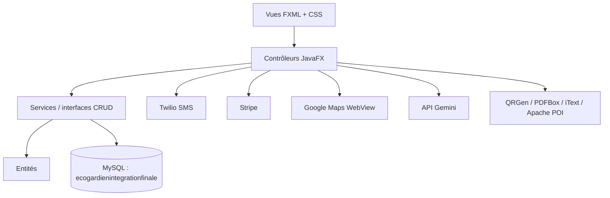

<div align="center">

# EcoGardien

**Application desktop JavaFX de gestion écologique : recyclage, éco-dépôts, consommation, événements, ateliers et boutique.**

*Projet intégré réalisé à ESPRIT par l'équipe **Mad Lions** (2023–2024)*


</div>

---

## Sommaire

- [Présentation](#présentation)
- [Mon module : Gestion du recyclage](#mon-module--gestion-du-recyclage)
- [Les autres modules](#les-autres-modules)
- [Architecture](#architecture)
- [Stack technique](#stack-technique)
- [Structure du projet](#structure-du-projet)
- [Installation](#installation)
- [Lancement](#lancement)
- [Équipe](#équipe)

---

## Présentation

**EcoGardien** est une plateforme qui encourage les comportements éco-responsables. Les utilisateurs déposent leurs produits recyclables dans des points de collecte, suivent leur consommation, participent à des événements et des ateliers, et achètent des produits durables. Les administrateurs disposent d'un back-office complet pour piloter chaque module.

Le projet suit une architecture en couches (entités, services, contrôleurs, vues FXML) sur une base MySQL commune. Chaque membre de l'équipe a développé un module sur sa propre branche, puis les modules ont été intégrés dans une application unique.

> Cette branche, **`ProduitRecyclable`**, contient l'intégration finale de l'application ainsi que le module de gestion du recyclage que j'ai développé.

## Mon module : Gestion du recyclage

Package `Recyclage` · vues dans `resources/ProduitRecyclable` et `resources/EcoDepot`

### Côté utilisateur : produits recyclables
- **CRUD complet** des produits recyclables (nom, description, type, quantité, date de dépôt) rattachés à l'utilisateur connecté et à un éco-dépôt.
- **Contrôle de saisie** : champs obligatoires, regex sur le nom, quantités entières positives.
- **Détection des doublons** : si un produit identique existe déjà, sa quantité est mise à jour au lieu de créer un nouveau produit.
- **Gestion de la capacité** : la capacité restante de l'éco-dépôt est vérifiée et décrémentée à chaque dépôt, avec une alerte quand il est presque plein ou saturé.
- **Notification SMS (Twilio)** envoyée à chaque nouveau dépôt, avec le récapitulatif du produit.
- **QR code** généré avec l'adresse de l'éco-dépôt associé (QRGen).
- **Diagnostic** : graphique (AreaChart) des quantités recyclées par type de produit.

### Côté administrateur : éco-dépôts
- **CRUD des points de collecte** : nom, adresse, type, capacité de stockage, statut.
- Suppression en cascade des produits liés à un éco-dépôt.
- **Statistiques** : PieChart de la capacité par type et BarChart par éco-dépôt.
- **Carte interactive** (WebView + Google Maps) pour rechercher et localiser un éco-dépôt par adresse.

## Les autres modules

| Module | Package | Fonctionnalités principales |
|---|---|---|
| Utilisateurs & réclamations | `EDU.userjava1` | Inscription, connexion avec hachage bcrypt et « se souvenir de moi », réinitialisation du mot de passe par e-mail et SMS, profils, gestion des utilisateurs par l'admin, réclamations, forum (conversations et commentaires avec filtre anti-insultes), assistant IA (Gemini), export PDF |
| Événements & partenaires | `edu.evenements` | CRUD des événements et partenaires, calendrier, avis, export Excel et PDF |
| Boutique | `com.example.demo` | Catalogue produits, panier, commandes, **paiement Stripe**, tableau de bord des ventes |
| Consommation & ateliers | `org.example` | Suivi de la consommation et des actions écologiques, gestion des types, ateliers (workshops), quiz et tests |

## Architecture



## Stack technique

| Domaine | Outils |
|---|---|
| Langage & UI | Java 17, JavaFX 17 (FXML, WebView, Charts), ControlsFX, AnimateFX, FontAwesomeFX |
| Build | Maven (wrapper inclus) |
| Base de données | MySQL 8, JDBC (`mysql-connector-java`) |
| APIs externes | Twilio (SMS), Stripe (paiement), Google Maps, Google Gemini, JavaMail |
| Documents | PDFBox, iText 7, Apache POI (Excel), QRGen (QR codes) |
| Sécurité | bcrypt, filtre de grossièretés (profanity-filter) |

## Structure du projet

```
src/main/
├── java/
│   ├── Recyclage/              # Module recyclage (produits recyclables + éco-dépôts)
│   │   ├── entities/           # ProduitRecyclable, EcoDepot
│   │   ├── interfaces/         # Contrats CRUD génériques
│   │   ├── services/           # Requêtes JDBC
│   │   ├── controllers/        # Contrôleurs JavaFX, carte, SMS, statistiques
│   │   └── tools/              # Connexion MySQL (singleton)
│   ├── EDU/userjava1/          # Utilisateurs, réclamations, forum, chatbot
│   ├── edu/evenements/         # Événements et partenaires
│   ├── com/example/demo/       # Boutique et paiement
│   ├── org/example/            # Consommation, actions, ateliers, quiz
│   └── module-info.java
└── resources/
    ├── ProduitRecyclable/      # Vues du module recyclage
    ├── EcoDepot/
    ├── HTML/Map.html           # Carte Google Maps
    ├── CSS/  style/  img/
    └── *.fxml
```

## Installation

### Prérequis
- JDK 17+
- MySQL 8 (XAMPP ou WAMP par exemple)
- Une IDE avec le support JavaFX (IntelliJ IDEA recommandé)

### Étapes

```bash
git clone -b ProduitRecyclable https://github.com/adam-hassen/java-Mad-Lions.git
cd java-Mad-Lions
./mvnw clean install
```

1. Créez une base MySQL nommée **`ecogardienintegrationfinale`** (utilisateur `root`, sans mot de passe par défaut) et importez-y le schéma du projet.
2. Renseignez vos propres clés pour les services externes : Twilio, Stripe, Gemini et le compte SMTP. Le mieux est de passer par des variables d'environnement plutôt que de les écrire dans le code.

## Lancement

```bash
./mvnw javafx:run
```

Le point d'entrée principal est `EDU.userjava1.controllers.test`, qui ouvre la page d'accueil EcoGardien. Pour tester uniquement le module recyclage :
- `Recyclage.tests.HelloApplication` lance l'ajout de produits recyclables ;
- `Recyclage.tests.HelloApplication2` lance le back-office des éco-dépôts.

## Équipe

Projet réalisé à **ESPRIT** par l'équipe **Mad Lions** :

- **Adam Hassen** — module Gestion du recyclage et intégration finale · [GitHub](https://github.com/adam-hassen) · [LinkedIn](https://linkedin.com/in/adam-hassen-06922b170)
- Youssef, Yasmine Ncib, Mehdi Kefi, Yassine, Amine — modules Utilisateurs, Événements, Boutique, Consommation et Ateliers

Chaque module a été développé sur sa propre branche (`GestionUser`, `GestionEvenemments`, `GestionProduit`, `GestionConsommation`, `GestionWorkshop`, `ProduitRecyclable`).
